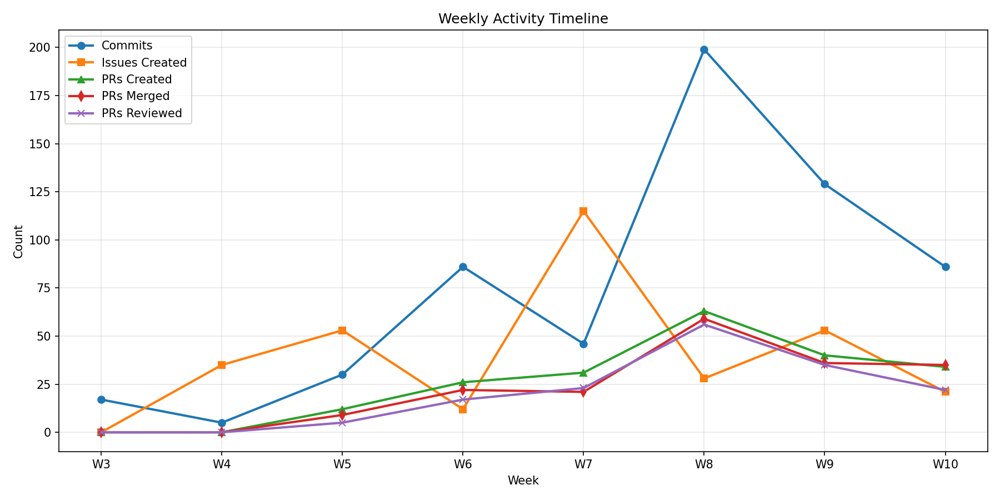
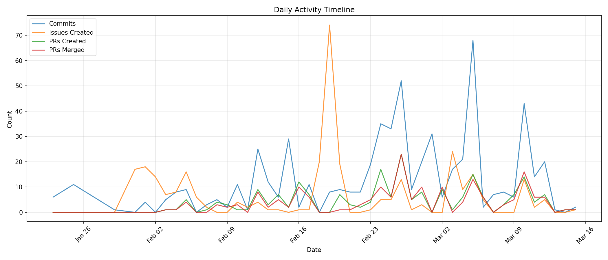

# Contributor Summary Report

**Repository:** edge-anomaly-mesh
**Branches:** origin/sprint-3
**Issue Milestones:** W26-Sprint-1, W26-Sprint-2, W26-Sprint-3
**Report Generated:** 2026-03-15 16:02:34

---

## Contributions

### Team Summary

| Team | Members | Commits | Issues | Comments | PRs Created | PRs Reviewed | PRs Commented | PRs Merged | Commits/Person |
|------|---------|---------|--------|----------|-------------|--------------|---------------|------------|----------------|
| DB | 3 | 150 | 69 | 27 | 46 | 33 | 24 | 89 | 50.0 |
| DE | 3 | 159 | 82 | 33 | 54 | 35 | 9 | 60 | 53.0 |
| ML | 4 | 119 | 91 | 10 | 62 | 29 | 9 | 36 | 29.8 |
| UI | 3 | 170 | 75 | 10 | 44 | 53 | 50 | 51 | 56.7 |

### By Individual

**Column Definitions:**
- **Contributions** — Weighted score: (Commits × 50%) + (Issues × 25%) + (PRs × 25%)
- **Commits** — Non-merge commits authored in sprint-3 branch
- **Commit +/-** — Percentage points above/below expected for team (expected = 100% / team size)
- **Files** — Unique files changed
- **Issues** — GitHub issues created
- **Comments** — GitHub issue comments
- **PRs Created** — Pull requests authored
- **PRs Reviewed** — Pull requests where contributor submitted a review
- **PRs Commented** — Pull requests where contributor left comments
- **PRs Merged** — PRs merged by contributor

| Contributor | Team | Contributions | Commits | Commit +/- | Files | Issues | Comments | PRs Created | PRs Reviewed | PRs Commented | PRs Merged |
|-------------|------|---------------|---------|------------|-------|--------|----------|-------------|--------------|---------------|------------|
| [Hannah Caldini](hannah_caldini.md) | DB | 71.0 | 90 | +27% | 20 | 30 | 12 | 18 | 11 | 4 | 50 |
| [Leo Liu](leo_liu.md) | DE | 68.0 | 85 | +20% | 51 | 33 | 19 | 20 | 0 | 0 | 14 |
| [Owen Conlon](owen_conlon.md) | UI | 56.2 | 52 | -3% | 13 | 29 | 5 | 11 | 29 | 28 | 11 |
| [Aldo Rios](aldo_rios.md) | DE | 55.0 | 48 | -3% | 66 | 33 | 0 | 14 | 28 | 7 | 34 |
| [Ty Esmond](ty_esmond.md) | UI | 54.5 | 51 | -3% | 15 | 25 | 3 | 19 | 15 | 14 | 25 |
| [George Rumsey](george_rumsey.md) | UI | 54.2 | 67 | +6% | 9 | 21 | 2 | 14 | 9 | 8 | 15 |
| [Alyssa Bulai](alyssa_bulai.md) | ML | 45.2 | 47 | +14% | 147 | 28 | 3 | 24 | 5 | 0 | 1 |
| [Daniel Kaplan](daniel_kaplan.md) | ML | 44.2 | 38 | +7% | 13 | 28 | 1 | 26 | 4 | 4 | 12 |
| [Diego Ramirez](diego_ramirez.md) | DB | 37.5 | 33 | -11% | 29 | 25 | 10 | 18 | 5 | 5 | 11 |
| [Kailar Hayes](kailar_hayes.md) | DB | 36.5 | 27 | -15% | 27 | 14 | 5 | 10 | 17 | 15 | 28 |
| [Sean Osman](sean_osman.md) | DE | 35.2 | 26 | -17% | 13 | 16 | 14 | 20 | 7 | 2 | 12 |
| [Truman Davis](truman_davis.md) | ML | 26.2 | 24 | -5% | 49 | 15 | 6 | 7 | 2 | 0 | 2 |
| [Tristian Bradley](tristian_bradley.md) | ML | 23.2 | 10 | -17% | 2 | 20 | 0 | 5 | 18 | 5 | 21 |
| **TOTAL** | | **607.2** | **598** | | **454** | **317** | **80** | **206** | **150** | **92** | **236** |

---

## Timeline

### Weekly Activity

### Daily Activity

---

*Contributions = (Commits × 50%) + (Issues Created + Issues Commented × 25%) + (PRs Created + PRs Closed + PRs Reviewed + PRs Commented + PRs Merged × 25%)*
