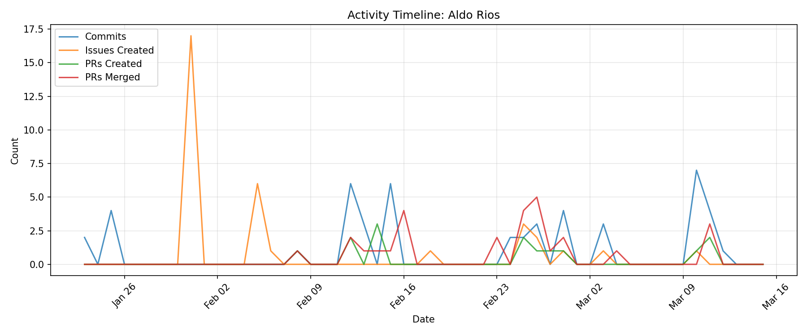

# Contributor Report: Aldo Rios

**GitHub Username(s):** arios123
**Email(s):** 124832719+arios123@users.noreply.github.com, aldorios369@gmail.com
**Report Generated:** 2026-03-15 16:01:29
**Branches Analyzed:** origin/sprint-3

---

## Summary

| Metric | Count |
|--------|-------|
| Total Commits | 48 |
| Lines Added | 768,852 |
| Lines Deleted | 604,976 |
| Net Lines Changed | +163,876 |
| PRs Created | 14 |
| PRs Assigned | 2 |
| PRs Reviewed | 28 |
| PRs Commented | 7 |
| PRs Merged (as merger) | 28 |
| Issues Created | 33 |
| Issues Commented | 0 |
| Files Changed | 66 |

---

## Issues

### Created (33)
#7, #8, #9, #10, #11, #14, #15, #16, #17, #18, #19, #20, #22, #25, #26, #27, #28, #115, #123, #125, #126, #127, #128, #130, #220, #384, #385, #386, #406, #426, #451, #485, #559

### Commented (0)
None

---

## Pull Requests

### Created (14)
#141, #159, #160, #174, #175, #178, #387, #389, #433, #436, #446, #560, #586, #591

### Assigned (2)
#138, #140

### Reviewed (28)
#138, #140, #162, #164, #169, #171, #177, #179, #180, #188, #189, #191, #192, #351, #352, #360, #362, #382, #401, #402, #414, #416, #420, #437, #447, #450, #498, #577

### Commented (7)
#138, #140, #351, #360, #362, #382, #420

### Merged (as merger) (28)
#140, #162, #164, #171, #177, #180, #188, #189, #191, #192, #351, #352, #360, #362, #365, #382, #401, #402, #414, #416, #420, #437, #447, #450, #498, #577, #587, #591

---

## Commits

Total non-merge commits in sprint-3 branch: **48**

### Code Changes
- **Lines Added:** 768,852
- **Lines Deleted:** 604,976
- **Net Change:** +163,876

---

## Files Changed (66)

- `README.md`
- `node-simulator/README.md`
- `node-simulator/redis/redis_setup.py`
- `node-simulator/redisFiles/redis_pub.py`
- `node-simulator/redisFiles/redis_setup.py`
- `node-simulator/requirements.txt`
- `node-simulator/routes/compactAllModes.json`
- `node-simulator/routes/exampleHub.json`
- `node-simulator/sims/NotBad.json`
- `node-simulator/sims/halfAnom.json`
- `node-simulator/sims/halfAnomGPS.json`
- `node-simulator/sims/linear.json`
- `node-simulator/sims/maritimeAnom.json`
- `node-simulator/sims/noAnom.json`
- `node-simulator/sims/ourAnom.json`
- `node-simulator/sims/terrestrialAnom.json`
- `node-simulator/simulation.py`
- `node-simulator/src/anomalies.py`
- `node-simulator/src/constants.py`
- `node-simulator/src/idle.py`
- `node-simulator/src/lift.py`
- `node-simulator/src/maritime.py`
- `node-simulator/src/node.py`
- `node-simulator/src/route.py`
- `node-simulator/src/terrestrial.py`
- `node-simulator/src/visualize.py`
- `simulator/.gitignore`
- `simulator/README.md`
- `simulator/base.py`
- `simulator/cli.py`
- `simulator/exampleHub.json`
- `simulator/exampleLift.json`
- `simulator/exampleMaritime.json`
- `simulator/exampleTerrestrial.json`
- `simulator/generators.py`
- `simulator/hub.py`
- `simulator/idle.py`
- `simulator/lift.py`
- `simulator/listener_tester.py`
- `simulator/maritime.json`
- `simulator/maritime.py`
- `simulator/node.py`
- `simulator/nodeConfig.json`
- `simulator/node_test.py`
- `simulator/old/generators.py`
- `simulator/old/listener_tester.py`
- `simulator/old/node_test.py`
- `simulator/old/publisher.py`
- `simulator/raw_data.json`
- `simulator/redis_test.py`
- `simulator/requirements.txt`
- `simulator/routes/exampleHub.json`
- `simulator/routes/exampleLift.json`
- `simulator/routes/exampleMaritime.json`
- `simulator/routes/exampleTerrestrial.json`
- `simulator/simulation.py`
- `simulator/src/hub.py`
- `simulator/src/idle.py`
- `simulator/src/lift.py`
- `simulator/src/maritime.py`
- `simulator/src/node.py`
- `simulator/src/noise.py`
- `simulator/src/route.py`
- `simulator/src/terrestrial.py`
- `test_data/full_simulation.json`
- `test_data/raw_data.json`

---

## Timeline

