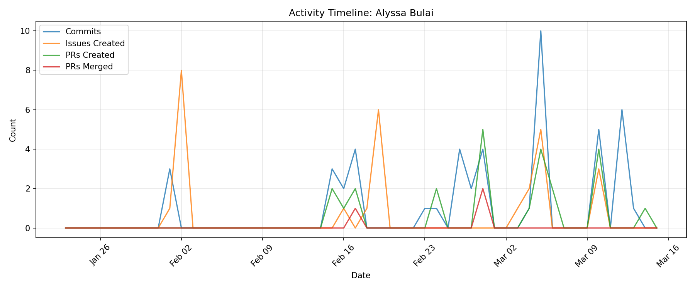

# Contributor Report: Alyssa Bulai

**GitHub Username(s):** alyssabulai
**Email(s):** alyssabulai@outlook.com
**Report Generated:** 2026-03-15 16:02:34
**Branches Analyzed:** origin/sprint-3

---

## Summary

| Metric | Count |
|--------|-------|
| Total Commits | 47 |
| Lines Added | 21,154,942 |
| Lines Deleted | 15,055,243 |
| Net Lines Changed | +6,099,699 |
| PRs Created | 24 |
| PRs Assigned | 1 |
| PRs Reviewed | 5 |
| PRs Commented | 0 |
| PRs Merged (as merger) | 3 |
| Issues Created | 28 |
| Issues Commented | 3 |
| Files Changed | 147 |

---

## Issues

### Created (28)
#45, #53, #54, #55, #56, #57, #58, #59, #60, #193, #208, #232, #233, #234, #255, #256, #257, #477, #493, #495, #516, #517, #532, #533, #537, #566, #568, #582

### Commented (3)
#233, #338, #340

---

## Pull Requests

### Created (24)
#183, #184, #194, #200, #201, #357, #366, #440, #441, #444, #445, #452, #505, #523, #526, #527, #536, #538, #544, #567, #569, #572, #584, #605

### Assigned (1)
#207

### Reviewed (5)
#372, #407, #408, #409, #411

### Commented (0)
None

### Merged (as merger) (3)
#207, #408, #440

---

## Commits

Total non-merge commits in sprint-3 branch: **47**

### Code Changes
- **Lines Added:** 21,154,942
- **Lines Deleted:** 15,055,243
- **Net Change:** +6,099,699

---

## Files Changed (147)

- `data/generate_training_data.py`
- `data/plots/terrestrial_detail.png`
- `data/training/balanced_idle_anomaly.json`
- `data/training/balanced_idle_normal.json`
- `data/training/balanced_lift_anomaly.json`
- `data/training/balanced_lift_normal.json`
- `data/training/balanced_maritime_anomaly.json`
- `data/training/balanced_maritime_normal.json`
- `data/training/balanced_terrestrial_anomaly.json`
- `data/training/balanced_terrestrial_normal.json`
- `data/training/metadata.json`
- `data/training/route_hub_denver_01_to_hub_estes_park_01.json`
- `data/training/route_hub_denver_01_to_hub_estes_park_01_drift.json`
- `data/training/route_hub_denver_01_to_hub_estes_park_01_dropout.json`
- `data/training/route_hub_denver_01_to_hub_estes_park_01_motion_mismatch.json`
- `data/training/route_hub_denver_01_to_hub_estes_park_01_spike.json`
- `data/training/route_hub_denver_01_to_hub_estes_park_01_with_lift.json`
- `data/training/route_hub_denver_01_to_hub_estes_park_01_with_lift_drift.json`
- `data/training/route_hub_denver_01_to_hub_estes_park_01_with_lift_dropout.json`
- `data/training/route_hub_denver_01_to_hub_estes_park_01_with_lift_motion_mismatch.json`
- `data/training/route_hub_denver_01_to_hub_estes_park_01_with_lift_spike.json`
- `data/training/route_hub_denver_01_to_hub_idaho_springs_01.json`
- `data/training/route_hub_denver_01_to_hub_idaho_springs_01_drift.json`
- `data/training/route_hub_denver_01_to_hub_idaho_springs_01_dropout.json`
- `data/training/route_hub_denver_01_to_hub_idaho_springs_01_motion_mismatch.json`
- `data/training/route_hub_denver_01_to_hub_idaho_springs_01_spike.json`
- `data/training/route_hub_denver_01_to_hub_idaho_springs_01_with_lift.json`
- `data/training/route_hub_denver_01_to_hub_idaho_springs_01_with_lift_drift.json`
- `data/training/route_hub_denver_01_to_hub_idaho_springs_01_with_lift_dropout.json`
- `data/training/route_hub_denver_01_to_hub_idaho_springs_01_with_lift_motion_mismatch.json`
- `data/training/route_hub_denver_01_to_hub_idaho_springs_01_with_lift_spike.json`
- `data/training/route_hub_estes_park_01_to_hub_denver_01.json`
- `data/training/route_hub_estes_park_01_to_hub_denver_01_drift.json`
- `data/training/route_hub_estes_park_01_to_hub_denver_01_dropout.json`
- `data/training/route_hub_estes_park_01_to_hub_denver_01_motion_mismatch.json`
- `data/training/route_hub_estes_park_01_to_hub_denver_01_spike.json`
- `data/training/route_hub_estes_park_01_to_hub_denver_01_with_lift.json`
- `data/training/route_hub_estes_park_01_to_hub_denver_01_with_lift_drift.json`
- `data/training/route_hub_estes_park_01_to_hub_denver_01_with_lift_dropout.json`
- `data/training/route_hub_estes_park_01_to_hub_denver_01_with_lift_motion_mismatch.json`
- `data/training/route_hub_estes_park_01_to_hub_denver_01_with_lift_spike.json`
- `data/training/route_hub_estes_park_01_to_hub_idaho_springs_01.json`
- `data/training/route_hub_estes_park_01_to_hub_idaho_springs_01_drift.json`
- `data/training/route_hub_estes_park_01_to_hub_idaho_springs_01_dropout.json`
- `data/training/route_hub_estes_park_01_to_hub_idaho_springs_01_motion_mismatch.json`
- `data/training/route_hub_estes_park_01_to_hub_idaho_springs_01_spike.json`
- `data/training/route_hub_estes_park_01_to_hub_idaho_springs_01_with_lift.json`
- `data/training/route_hub_estes_park_01_to_hub_idaho_springs_01_with_lift_drift.json`
- `data/training/route_hub_estes_park_01_to_hub_idaho_springs_01_with_lift_dropout.json`
- `data/training/route_hub_estes_park_01_to_hub_idaho_springs_01_with_lift_motion_mismatch.json`
- `data/training/route_hub_estes_park_01_to_hub_idaho_springs_01_with_lift_spike.json`
- `data/training/route_hub_idaho_springs_01_to_hub_denver_01.json`
- `data/training/route_hub_idaho_springs_01_to_hub_denver_01_drift.json`
- `data/training/route_hub_idaho_springs_01_to_hub_denver_01_dropout.json`
- `data/training/route_hub_idaho_springs_01_to_hub_denver_01_motion_mismatch.json`
- `data/training/route_hub_idaho_springs_01_to_hub_denver_01_spike.json`
- `data/training/route_hub_idaho_springs_01_to_hub_denver_01_with_lift.json`
- `data/training/route_hub_idaho_springs_01_to_hub_denver_01_with_lift_drift.json`
- `data/training/route_hub_idaho_springs_01_to_hub_denver_01_with_lift_dropout.json`
- `data/training/route_hub_idaho_springs_01_to_hub_denver_01_with_lift_motion_mismatch.json`
- `data/training/route_hub_idaho_springs_01_to_hub_denver_01_with_lift_spike.json`
- `data/training/route_hub_idaho_springs_01_to_hub_estes_park_01.json`
- `data/training/route_hub_idaho_springs_01_to_hub_estes_park_01_drift.json`
- `data/training/route_hub_idaho_springs_01_to_hub_estes_park_01_dropout.json`
- `data/training/route_hub_idaho_springs_01_to_hub_estes_park_01_motion_mismatch.json`
- `data/training/route_hub_idaho_springs_01_to_hub_estes_park_01_spike.json`
- `data/training/route_hub_idaho_springs_01_to_hub_estes_park_01_with_lift.json`
- `data/training/route_hub_idaho_springs_01_to_hub_estes_park_01_with_lift_drift.json`
- `data/training/route_hub_idaho_springs_01_to_hub_estes_park_01_with_lift_dropout.json`
- `data/training/route_hub_idaho_springs_01_to_hub_estes_park_01_with_lift_motion_mismatch.json`
- `data/training/route_hub_idaho_springs_01_to_hub_estes_park_01_with_lift_spike.json`
- `data/training/route_hub_la_port_01_to_hub_oakland_port_01_maritime.json`
- `data/training/route_hub_la_port_01_to_hub_oakland_port_01_maritime_drift.json`
- `data/training/route_hub_la_port_01_to_hub_oakland_port_01_maritime_dropout.json`
- `data/training/route_hub_la_port_01_to_hub_oakland_port_01_maritime_motion_mismatch.json`
- `data/training/route_hub_la_port_01_to_hub_oakland_port_01_maritime_spike.json`
- `data/training/route_hub_la_port_01_to_hub_oakland_port_01_maritime_with_lift.json`
- `data/training/route_hub_la_port_01_to_hub_oakland_port_01_maritime_with_lift_drift.json`
- `data/training/route_hub_la_port_01_to_hub_oakland_port_01_maritime_with_lift_dropout.json`
- `data/training/route_hub_la_port_01_to_hub_oakland_port_01_maritime_with_lift_motion_mismatch.json`
- `data/training/route_hub_la_port_01_to_hub_oakland_port_01_maritime_with_lift_spike.json`
- `data/training/route_hub_la_port_01_to_hub_seattle_port_01_maritime.json`
- `data/training/route_hub_la_port_01_to_hub_seattle_port_01_maritime_drift.json`
- `data/training/route_hub_la_port_01_to_hub_seattle_port_01_maritime_dropout.json`
- `data/training/route_hub_la_port_01_to_hub_seattle_port_01_maritime_motion_mismatch.json`
- `data/training/route_hub_la_port_01_to_hub_seattle_port_01_maritime_spike.json`
- `data/training/route_hub_la_port_01_to_hub_seattle_port_01_maritime_with_lift.json`
- `data/training/route_hub_la_port_01_to_hub_seattle_port_01_maritime_with_lift_drift.json`
- `data/training/route_hub_la_port_01_to_hub_seattle_port_01_maritime_with_lift_dropout.json`
- `data/training/route_hub_la_port_01_to_hub_seattle_port_01_maritime_with_lift_motion_mismatch.json`
- `data/training/route_hub_la_port_01_to_hub_seattle_port_01_maritime_with_lift_spike.json`
- `data/training/route_hub_oakland_port_01_to_hub_la_port_01_maritime.json`
- `data/training/route_hub_oakland_port_01_to_hub_la_port_01_maritime_drift.json`
- `data/training/route_hub_oakland_port_01_to_hub_la_port_01_maritime_dropout.json`
- `data/training/route_hub_oakland_port_01_to_hub_la_port_01_maritime_motion_mismatch.json`
- `data/training/route_hub_oakland_port_01_to_hub_la_port_01_maritime_spike.json`
- `data/training/route_hub_oakland_port_01_to_hub_la_port_01_maritime_with_lift.json`
- `data/training/route_hub_oakland_port_01_to_hub_la_port_01_maritime_with_lift_drift.json`
- `data/training/route_hub_oakland_port_01_to_hub_la_port_01_maritime_with_lift_dropout.json`
- `data/training/route_hub_oakland_port_01_to_hub_la_port_01_maritime_with_lift_motion_mismatch.json`
- `data/training/route_hub_oakland_port_01_to_hub_la_port_01_maritime_with_lift_spike.json`
- `data/training/route_hub_oakland_port_01_to_hub_seattle_port_01_maritime.json`
- `data/training/route_hub_oakland_port_01_to_hub_seattle_port_01_maritime_drift.json`
- `data/training/route_hub_oakland_port_01_to_hub_seattle_port_01_maritime_dropout.json`
- `data/training/route_hub_oakland_port_01_to_hub_seattle_port_01_maritime_motion_mismatch.json`
- `data/training/route_hub_oakland_port_01_to_hub_seattle_port_01_maritime_spike.json`
- `data/training/route_hub_oakland_port_01_to_hub_seattle_port_01_maritime_with_lift.json`
- `data/training/route_hub_oakland_port_01_to_hub_seattle_port_01_maritime_with_lift_drift.json`
- `data/training/route_hub_oakland_port_01_to_hub_seattle_port_01_maritime_with_lift_dropout.json`
- `data/training/route_hub_oakland_port_01_to_hub_seattle_port_01_maritime_with_lift_motion_mismatch.json`
- `data/training/route_hub_oakland_port_01_to_hub_seattle_port_01_maritime_with_lift_spike.json`
- `data/training/route_hub_seattle_port_01_to_hub_la_port_01_maritime.json`
- `data/training/route_hub_seattle_port_01_to_hub_la_port_01_maritime_drift.json`
- `data/training/route_hub_seattle_port_01_to_hub_la_port_01_maritime_dropout.json`
- `data/training/route_hub_seattle_port_01_to_hub_la_port_01_maritime_motion_mismatch.json`
- `data/training/route_hub_seattle_port_01_to_hub_la_port_01_maritime_spike.json`
- `data/training/route_hub_seattle_port_01_to_hub_la_port_01_maritime_with_lift.json`
- `data/training/route_hub_seattle_port_01_to_hub_la_port_01_maritime_with_lift_drift.json`
- `data/training/route_hub_seattle_port_01_to_hub_la_port_01_maritime_with_lift_dropout.json`
- `data/training/route_hub_seattle_port_01_to_hub_la_port_01_maritime_with_lift_motion_mismatch.json`
- `data/training/route_hub_seattle_port_01_to_hub_la_port_01_maritime_with_lift_spike.json`
- `data/training/route_hub_seattle_port_01_to_hub_oakland_port_01_maritime.json`
- `data/training/route_hub_seattle_port_01_to_hub_oakland_port_01_maritime_drift.json`
- `data/training/route_hub_seattle_port_01_to_hub_oakland_port_01_maritime_dropout.json`
- `data/training/route_hub_seattle_port_01_to_hub_oakland_port_01_maritime_motion_mismatch.json`
- `data/training/route_hub_seattle_port_01_to_hub_oakland_port_01_maritime_spike.json`
- `data/training/route_hub_seattle_port_01_to_hub_oakland_port_01_maritime_with_lift.json`
- `data/training/route_hub_seattle_port_01_to_hub_oakland_port_01_maritime_with_lift_drift.json`
- `data/training/route_hub_seattle_port_01_to_hub_oakland_port_01_maritime_with_lift_dropout.json`
- `data/training/route_hub_seattle_port_01_to_hub_oakland_port_01_maritime_with_lift_motion_mismatch.json`
- `data/training/route_hub_seattle_port_01_to_hub_oakland_port_01_maritime_with_lift_spike.json`
- `machine-learning/classifier_preparation.py`
- `machine-learning/model_training.py`
- `machine-learning/test_model.py`
- `machine-learning/train_classifier.py`
- `ml/README.md`
- `ml/classifier/normalization_stats.json`
- `ml/data_pipeline.py`
- `ml/redis_insteam.py`
- `ml/redis_outstream.py`
- `ml/train_classifier.py`
- `models/inference_results.json`
- `models/motion_classifier.pt`
- `models/training_history.json`
- `tests/test-machine-learning/test_confidence_score.py`
- `tests/test-machine-learning/test_label_distribution_validation.py`
- `tests/test-machine-learning/test_load_all_data_filtering.py`

---

## Timeline

