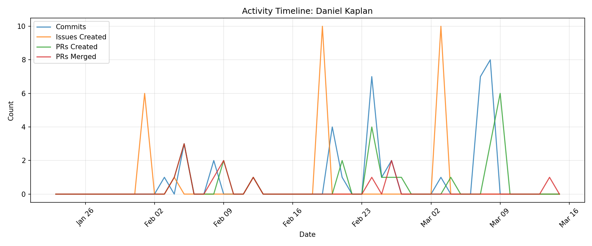

# Contributor Report: Daniel Kaplan

**GitHub Username(s):** danielkaplan32
**Email(s):** daniel.kaplan32@du.edu
**Report Generated:** 2026-03-15 16:02:20
**Branches Analyzed:** origin/sprint-3

---

## Summary

| Metric | Count |
|--------|-------|
| Total Commits | 38 |
| Lines Added | 2,193 |
| Lines Deleted | 370 |
| Net Lines Changed | +1,823 |
| PRs Created | 26 |
| PRs Assigned | 6 |
| PRs Reviewed | 4 |
| PRs Commented | 4 |
| PRs Merged (as merger) | 12 |
| Issues Created | 28 |
| Issues Commented | 1 |
| Files Changed | 13 |

---

## Issues

### Created (28)
#46, #47, #48, #49, #50, #51, #97, #165, #235, #236, #237, #238, #239, #240, #241, #242, #273, #274, #464, #465, #466, #467, #468, #469, #470, #471, #472, #473

### Commented (1)
#49

---

## Pull Requests

### Created (26)
#106, #108, #109, #110, #142, #143, #168, #346, #348, #364, #367, #368, #370, #391, #432, #438, #500, #549, #550, #551, #552, #553, #554, #555, #556, #557

### Assigned (6)
#106, #108, #109, #110, #142, #143

### Reviewed (4)
#369, #419, #421, #605

### Commented (4)
#369, #419, #421, #605

### Merged (as merger) (12)
#106, #108, #109, #110, #139, #142, #143, #167, #369, #419, #421, #605

---

## Commits

Total non-merge commits in sprint-3 branch: **38**

### Code Changes
- **Lines Added:** 2,193
- **Lines Deleted:** 370
- **Net Change:** +1,823

---

## Files Changed (13)

- `machine-learning/classifier_preparation.py`
- `machine-learning/model_training.py`
- `machine-learning/train_classifier.py`
- `ml/README.md`
- `ml/data_pipeline.py`
- `ml/feature_extraction.py`
- `ml/redis_insteam.py`
- `ml/requirements.txt`
- `tests/test-machine-learning/test_duplicate_filtering.py`
- `tests/test-machine-learning/test_event_sorting.py`
- `tests/test-machine-learning/test_json_loading.py`
- `tests/test-machine-learning/test_streamer_pipeline.py`
- `tests/test-machine-learning/test_windowing.py`

---

## Timeline

