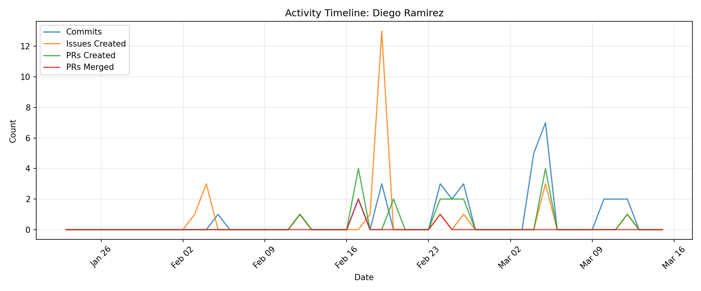

# Contributor Report: Diego Ramirez

**GitHub Username(s):** Diego-Ramirez64
**Email(s):** diegoiramirez42@gmail.com
**Report Generated:** 2026-03-15 16:02:18
**Branches Analyzed:** origin/sprint-3

---

## Summary

| Metric | Count |
|--------|-------|
| Total Commits | 33 |
| Lines Added | 1,085 |
| Lines Deleted | 673 |
| Net Lines Changed | +412 |
| PRs Created | 18 |
| PRs Assigned | 9 |
| PRs Reviewed | 5 |
| PRs Commented | 5 |
| PRs Merged (as merger) | 3 |
| Issues Created | 25 |
| Issues Commented | 10 |
| Files Changed | 29 |

---

## Issues

### Created (25)
#82, #96, #100, #101, #158, #219, #244, #252, #254, #258, #260, #261, #277, #279, #280, #282, #288, #289, #290, #383, #412, #512, #514, #525, #595

### Commented (10)
#98, #99, #158, #211, #219, #244, #260, #261, #363, #398

---

## Pull Requests

### Created (18)
#156, #203, #204, #205, #206, #319, #321, #361, #363, #394, #395, #404, #405, #513, #515, #522, #528, #596

### Assigned (9)
#113, #137, #152, #185, #198, #398, #428, #457, #596

### Reviewed (5)
#137, #152, #320, #429, #524

### Commented (5)
#137, #152, #320, #429, #524

### Merged (as merger) (3)
#204, #205, #320

---

## Commits

Total non-merge commits in sprint-3 branch: **33**

### Code Changes
- **Lines Added:** 1,085
- **Lines Deleted:** 673
- **Net Change:** +412

---

## Files Changed (29)

- `.gitignore`
- `CLAUDE.md`
- `database/README.md`
- `database/anomaly_events.db`
- `database/db_table_manager.py`
- `database/example_inference.json`
- `database/example_raw.json`
- `database/inference_results.db`
- `database/ml_tables.py`
- `database/redis_listener.py`
- `database/requirements.txt`
- `database/schema.py`
- `database/test_insert.py`
- `reports/CLAUDE.md`
- `reports/SUMMARY.md`
- `reports/aldo_rios.md`
- `reports/alyssa_bulai.md`
- `reports/daniel_kaplan.md`
- `reports/diego_ramirez.md`
- `reports/generate_reports.py`
- `reports/george_rumsey.md`
- `reports/hannah_caldini.md`
- `reports/kailar_hayes.md`
- `reports/leo_liu.md`
- `reports/owen_conlon.md`
- `reports/sean_osman.md`
- `reports/tristian_bradley.md`
- `reports/truman_davis.md`
- `reports/ty_esmond.md`

---

## Timeline

