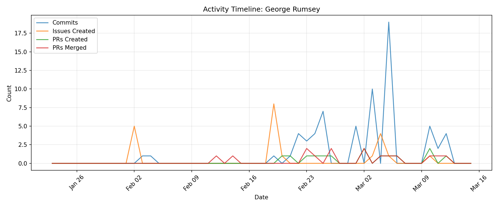

# Contributor Report: George Rumsey

**GitHub Username(s):** georgerumsey
**Email(s):** 123426918+georgerumsey@users.noreply.github.com, george.rumsey@du.edu
**Report Generated:** 2026-03-15 16:01:59
**Branches Analyzed:** origin/sprint-3

---

## Summary

| Metric | Count |
|--------|-------|
| Total Commits | 67 |
| Lines Added | 26,410 |
| Lines Deleted | 733 |
| Net Lines Changed | +25,677 |
| PRs Created | 14 |
| PRs Assigned | 25 |
| PRs Reviewed | 9 |
| PRs Commented | 8 |
| PRs Merged (as merger) | 15 |
| Issues Created | 21 |
| Issues Commented | 2 |
| Files Changed | 9 |

---

## Issues

### Created (21)
#71, #72, #73, #75, #76, #263, #267, #272, #275, #276, #278, #287, #308, #315, #487, #489, #490, #491, #492, #535, #578

### Commented (2)
#173, #388

---

## Pull Requests

### Created (14)
#335, #347, #353, #356, #388, #399, #455, #459, #499, #520, #545, #564, #585, #601

### Assigned (25)
#107, #144, #172, #186, #195, #199, #336, #337, #350, #358, #396, #397, #427, #435, #439, #453, #456, #458, #506, #546, #558, #562, #590, #594, #602

### Reviewed (9)
#350, #396, #397, #427, #435, #458, #506, #546, #562

### Commented (8)
#396, #397, #427, #435, #458, #506, #546, #562

### Merged (as merger) (15)
#155, #173, #335, #353, #356, #388, #399, #455, #459, #499, #520, #545, #564, #585, #601

---

## Commits

Total non-merge commits in sprint-3 branch: **67**

### Code Changes
- **Lines Added:** 26,410
- **Lines Deleted:** 733
- **Net Change:** +25,677

---

## Files Changed (9)

- `ui/README.md`
- `ui/requirements.txt`
- `ui/sample_data/sample_anomaly_data.json`
- `ui/ui_utils.py`
- `ui/widgets/analytics_tab.py`
- `ui/widgets/anomalies_tab.py`
- `ui/widgets/dashboard_main.py`
- `ui/widgets/network_tab.py`
- `ui/widgets/node_details_tab.py`

---

## Timeline

