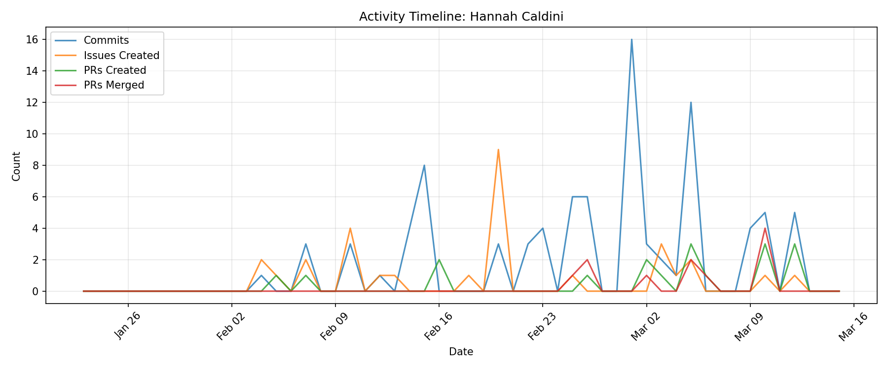

# Contributor Report: Hannah Caldini

**GitHub Username(s):** hcaldini
**Email(s):** 166074733+hcaldini@users.noreply.github.com, hannah.caldini@du.edu
**Report Generated:** 2026-03-15 16:02:15
**Branches Analyzed:** origin/sprint-3

---

## Summary

| Metric | Count |
|--------|-------|
| Total Commits | 90 |
| Lines Added | 4,520 |
| Lines Deleted | 1,273 |
| Net Lines Changed | +3,247 |
| PRs Created | 18 |
| PRs Assigned | 5 |
| PRs Reviewed | 11 |
| PRs Commented | 4 |
| PRs Merged (as merger) | 11 |
| Issues Created | 30 |
| Issues Commented | 12 |
| Files Changed | 20 |

---

## Issues

### Created (30)
#104, #105, #121, #135, #136, #146, #147, #148, #149, #161, #170, #231, #322, #324, #325, #326, #327, #328, #329, #330, #331, #390, #462, #463, #476, #494, #518, #534, #575, #604

### Commented (12)
#231, #247, #322, #324, #326, #327, #329, #462, #463, #476, #518, #543

---

## Pull Requests

### Created (18)
#113, #137, #185, #198, #428, #457, #460, #478, #511, #519, #524, #541, #561, #563, #583, #597, #598, #599

### Assigned (5)
#113, #152, #398, #428, #511

### Reviewed (11)
#152, #156, #363, #395, #398, #405, #454, #461, #509, #515, #530

### Commented (4)
#152, #363, #398, #454

### Merged (as merger) (11)
#395, #398, #405, #461, #509, #515, #519, #530, #561, #563, #583

---

## Commits

Total non-merge commits in sprint-3 branch: **90**

### Code Changes
- **Lines Added:** 4,520
- **Lines Deleted:** 1,273
- **Net Change:** +3,247

---

## Files Changed (20)

- `database/README.md`
- `database/db_message.py`
- `database/db_message_factory.py`
- `database/db_message_manager.py`
- `database/message_outputs.md`
- `database/message_test.py`
- `database/nodes.db`
- `database/nodes.db-shm`
- `database/nodes.db-wal`
- `database/nodes_table.py`
- `database/nodes_test.db`
- `database/queries.py`
- `database/redis_listener.py`
- `database/requirements.txt`
- `database/sample_message_data.json`
- `database/sample_message_requests.json`
- `database/sample_message_response.json`
- `database/sample_message_responses.json`
- `database/sample_raw_data.json`
- `database/schema.py`

---

## Timeline

