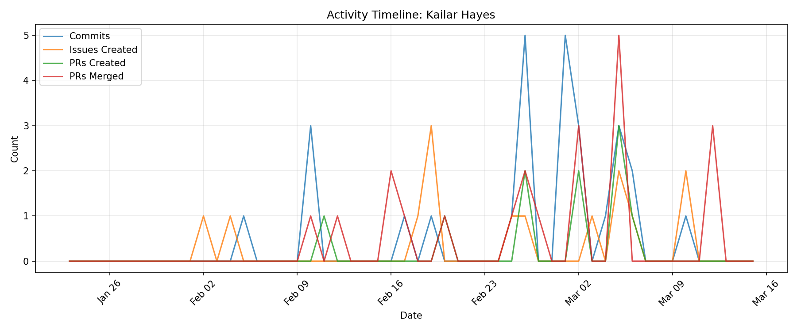

# Contributor Report: Kailar Hayes

**GitHub Username(s):** Kailar-Hayes
**Email(s):** 165724913+Kailar-Hayes@users.noreply.github.com, kailar.hayes@du.edu
**Report Generated:** 2026-03-15 16:02:08
**Branches Analyzed:** origin/sprint-3

---

## Summary

| Metric | Count |
|--------|-------|
| Total Commits | 27 |
| Lines Added | 802,021 |
| Lines Deleted | 1,353 |
| Net Lines Changed | +800,668 |
| PRs Created | 10 |
| PRs Assigned | 6 |
| PRs Reviewed | 17 |
| PRs Commented | 15 |
| PRs Merged (as merger) | 21 |
| Issues Created | 14 |
| Issues Commented | 5 |
| Files Changed | 27 |

---

## Issues

### Created (14)
#63, #103, #211, #264, #293, #303, #392, #410, #482, #507, #529, #547, #570, #574

### Commented (5)
#84, #474, #476, #547, #574

---

## Pull Requests

### Created (10)
#152, #320, #398, #429, #454, #461, #508, #509, #530, #548

### Assigned (6)
#113, #137, #185, #198, #428, #457

### Reviewed (17)
#156, #185, #198, #206, #321, #404, #428, #457, #511, #513, #522, #524, #528, #561, #596, #598, #599

### Commented (15)
#156, #185, #206, #321, #404, #428, #457, #511, #513, #522, #524, #528, #561, #596, #598

### Merged (as merger) (21)
#137, #152, #156, #185, #206, #321, #363, #404, #428, #429, #454, #457, #460, #511, #513, #522, #524, #528, #596, #598, #599

---

## Commits

Total non-merge commits in sprint-3 branch: **27**

### Code Changes
- **Lines Added:** 802,021
- **Lines Deleted:** 1,353
- **Net Change:** +800,668

---

## Files Changed (27)

- `.gitignore`
- `database/anomaly_events.db`
- `database/db_message.py`
- `database/db_message_manager.py`
- `database/db_table_manager.py`
- `database/example-data/example_inference_results.json`
- `database/example-data/sample_message_data.json`
- `database/example-data/sample_message_requests.json`
- `database/example-data/sample_message_responses.json`
- `database/example-data/sample_raw_data.json`
- `database/example_inference_results.json`
- `database/inference_results.db`
- `database/message_outputs.md`
- `database/ml_tables.py`
- `database/nodes.db`
- `database/nodes_table.py`
- `database/nodes_test.db`
- `database/queries.py`
- `database/raw_data_table.py`
- `database/redis_listener.py`
- `database/requirements.txt`
- `database/schema.py`
- `database/sensor_data.db`
- `database/sensor_data.db-shm`
- `database/sensor_data.db-wal`
- `database/test_queries.py`
- `simulator/raw_data.json`

---

## Timeline

