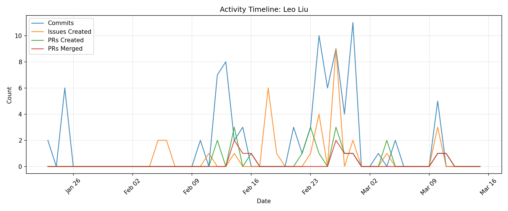

# Contributor Report: Leo Liu

**GitHub Username(s):** LSRLeo
**Email(s):** shirui.liu@du.edu, leoliu20041217@gmail.com
**Report Generated:** 2026-03-15 16:01:29
**Branches Analyzed:** origin/sprint-3

---

## Summary

| Metric | Count |
|--------|-------|
| Total Commits | 85 |
| Lines Added | 1,866 |
| Lines Deleted | 1,034 |
| Net Lines Changed | +832 |
| PRs Created | 20 |
| PRs Assigned | 0 |
| PRs Reviewed | 0 |
| PRs Commented | 0 |
| PRs Merged (as merger) | 10 |
| Issues Created | 33 |
| Issues Commented | 19 |
| Files Changed | 51 |

---

## Issues

### Created (33)
#122, #124, #129, #131, #154, #176, #222, #223, #224, #225, #227, #230, #302, #354, #371, #373, #375, #377, #400, #403, #413, #417, #418, #422, #423, #424, #431, #442, #443, #496, #576, #580, #581

### Commented (19)
#8, #21, #27, #122, #153, #154, #181, #223, #225, #227, #228, #229, #343, #354, #417, #431, #443, #448, #496

---

## Pull Requests

### Created (20)
#163, #164, #177, #179, #180, #191, #349, #351, #352, #355, #365, #401, #402, #420, #437, #450, #497, #498, #579, #587

### Assigned (0)
None

### Reviewed (0)
None

### Commented (0)
None

### Merged (as merger) (10)
#174, #175, #178, #197, #415, #433, #436, #446, #560, #586

---

## Commits

Total non-merge commits in sprint-3 branch: **85**

### Code Changes
- **Lines Added:** 1,866
- **Lines Deleted:** 1,034
- **Net Change:** +832

---

## Files Changed (51)

- `node-simulator/.gitignore`
- `node-simulator/README.md`
- `node-simulator/example_files/README.md`
- `node-simulator/example_files/__init__.py`
- `node-simulator/example_files/hub_manager.py`
- `node-simulator/example_files/motion_generators/__init__.py`
- `node-simulator/example_files/motion_generators/base.py`
- `node-simulator/example_files/motion_generators/idle.py`
- `node-simulator/example_files/motion_generators/lift.py`
- `node-simulator/example_files/motion_generators/maritime.py`
- `node-simulator/example_files/motion_generators/terrestrial.py`
- `node-simulator/example_files/node_simulator.py`
- `node-simulator/example_files/redis_publisher.py`
- `node-simulator/example_files/run_simulator.py`
- `node-simulator/example_files/training_data_generator.py`
- `node-simulator/nodeConfig.json`
- `node-simulator/old/generators.py`
- `node-simulator/old/listener_tester.py`
- `node-simulator/old/node_test.py`
- `node-simulator/old/publisher.py`
- `node-simulator/requirements.txt`
- `node-simulator/routes/exampleHub.json`
- `node-simulator/routes/exampleHubLabel.json`
- `node-simulator/routes/exampleLift.json`
- `node-simulator/routes/exampleMaritime.json`
- `node-simulator/routes/exampleTerrestrial.json`
- `node-simulator/routes/exampleWaypoints.json`
- `node-simulator/routes/updatedExampleHub.json`
- `node-simulator/simulation.py`
- `node-simulator/src/hub.py`
- `node-simulator/src/idle.py`
- `node-simulator/src/lift.py`
- `node-simulator/src/maritime.py`
- `node-simulator/src/node.py`
- `node-simulator/src/noise.py`
- `node-simulator/src/route.py`
- `node-simulator/src/segment.py`
- `node-simulator/src/terrestrial.py`
- `node-simulator/src/wapoint.py`
- `node-simulator/src/waypoint.py`
- `node-simulator/src/waypointsMaker.py`
- `redis_test.py`
- `simulator/README.md`
- `simulator/exampleHub.json`
- `simulator/exampleTerrestrial.json`
- `simulator/node.py`
- `simulator/publisher.py`
- `simulator/redis_test.py`
- `simulator/route.py`
- `simulator/section.py`
- `simulator/terrestrial.py`

---

## Timeline

