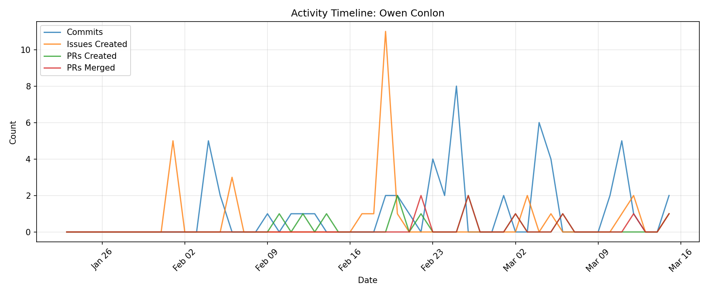

# Contributor Report: Owen Conlon

**GitHub Username(s):** ohenconlon
**Email(s):** 167807269+ohenconlon@users.noreply.github.com, owen.conlon@du.edu
**Report Generated:** 2026-03-15 16:01:53
**Branches Analyzed:** origin/sprint-3

---

## Summary

| Metric | Count |
|--------|-------|
| Total Commits | 52 |
| Lines Added | 711,580 |
| Lines Deleted | 711,216 |
| Net Lines Changed | +364 |
| PRs Created | 11 |
| PRs Assigned | 28 |
| PRs Reviewed | 29 |
| PRs Commented | 28 |
| PRs Merged (as merger) | 8 |
| Issues Created | 29 |
| Issues Commented | 5 |
| Files Changed | 13 |

---

## Issues

### Created (29)
#29, #33, #34, #35, #36, #132, #133, #134, #202, #217, #243, #245, #248, #251, #268, #281, #284, #291, #292, #296, #313, #344, #484, #488, #521, #589, #592, #593, #606

### Commented (5)
#33, #217, #268, #296, #336

---

## Pull Requests

### Created (11)
#145, #155, #173, #336, #337, #350, #396, #397, #456, #546, #607

### Assigned (28)
#107, #144, #155, #172, #173, #186, #195, #199, #336, #337, #350, #358, #396, #397, #427, #435, #439, #453, #456, #458, #506, #546, #558, #562, #590, #594, #602, #607

### Reviewed (29)
#107, #144, #172, #186, #195, #199, #335, #353, #356, #358, #388, #399, #427, #435, #439, #453, #455, #458, #459, #499, #506, #520, #545, #558, #562, #564, #590, #594, #602

### Commented (28)
#107, #144, #172, #195, #199, #335, #353, #356, #358, #388, #399, #427, #435, #439, #453, #455, #458, #459, #499, #506, #520, #545, #558, #562, #564, #590, #594, #602

### Merged (as merger) (8)
#337, #350, #396, #397, #456, #546, #594, #607

---

## Commits

Total non-merge commits in sprint-3 branch: **52**

### Code Changes
- **Lines Added:** 711,580
- **Lines Deleted:** 711,216
- **Net Change:** +364

---

## Files Changed (13)

- `ui/README.md`
- `ui/redis_reader.py`
- `ui/requirements.txt`
- `ui/widgets/analytics_tab.py`
- `ui/widgets/anomalies_tab.py`
- `ui/widgets/dashboard_main.py`
- `ui/widgets/ml_data.json`
- `ui/widgets/network_tab.py`
- `ui/widgets/node_details_tab.py`
- `ui/widgets/parent_classes.py`
- `ui/widgets/raw_data.json`
- `ui/widgets/test_nodes.json`
- `ui/widgets/widgetextras/mercator.jpg`

---

## Timeline

