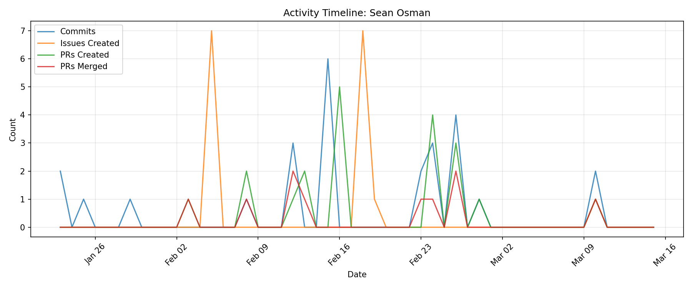

# Contributor Report: Sean Osman

**GitHub Username(s):** Sean-Osman
**Email(s):** 96084662+Sean-Osman@users.noreply.github.com
**Report Generated:** 2026-03-15 16:01:14
**Branches Analyzed:** origin/sprint-3

---

## Summary

| Metric | Count |
|--------|-------|
| Total Commits | 26 |
| Lines Added | 7,920 |
| Lines Deleted | 1,615 |
| Net Lines Changed | +6,305 |
| PRs Created | 20 |
| PRs Assigned | 2 |
| PRs Reviewed | 7 |
| PRs Commented | 2 |
| PRs Merged (as merger) | 10 |
| Issues Created | 16 |
| Issues Commented | 14 |
| Files Changed | 13 |

---

## Issues

### Created (16)
#112, #114, #116, #117, #118, #119, #120, #209, #210, #212, #214, #215, #216, #218, #310, #565

### Commented (14)
#11, #14, #15, #112, #114, #116, #117, #118, #119, #120, #141, #355, #365, #451

---

## Pull Requests

### Created (20)
#77, #138, #140, #162, #169, #171, #188, #189, #192, #196, #197, #359, #360, #362, #382, #414, #415, #416, #447, #577

### Assigned (2)
#138, #140

### Reviewed (7)
#159, #160, #365, #387, #389, #420, #579

### Commented (2)
#159, #160

### Merged (as merger) (10)
#77, #141, #159, #160, #169, #355, #359, #387, #389, #579

---

## Commits

Total non-merge commits in sprint-3 branch: **26**

### Code Changes
- **Lines Added:** 7,920
- **Lines Deleted:** 1,615
- **Net Change:** +6,305

---

## Files Changed (13)

- `node-simulator/src/anomalies.py`
- `node-simulator/src/idle.py`
- `node-simulator/src/lift.py`
- `node-simulator/src/maritime.py`
- `node-simulator/src/node.py`
- `node-simulator/src/terrestrial.py`
- `simulator/cli.py`
- `simulator/generators.py`
- `simulator/lift.py`
- `simulator/node.py`
- `simulator/noise.py`
- `simulator/raw_data.json`
- `simulator/redis_test.py`

---

## Timeline

