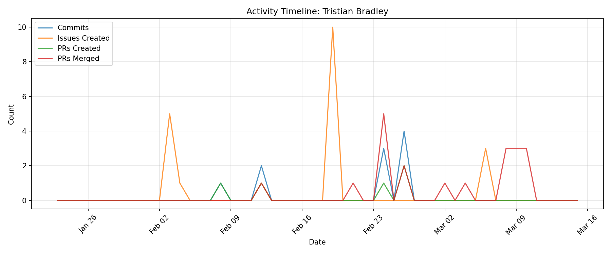

# Contributor Report: Tristian Bradley

**GitHub Username(s):** TBradley06
**Email(s):** tristian.bradley@du.edu
**Report Generated:** 2026-03-15 16:02:30
**Branches Analyzed:** origin/sprint-3

---

## Summary

| Metric | Count |
|--------|-------|
| Total Commits | 10 |
| Lines Added | 277 |
| Lines Deleted | 49 |
| Net Lines Changed | +228 |
| PRs Created | 5 |
| PRs Assigned | 10 |
| PRs Reviewed | 18 |
| PRs Commented | 5 |
| PRs Merged (as merger) | 20 |
| Issues Created | 20 |
| Issues Commented | 0 |
| Files Changed | 2 |

---

## Issues

### Created (20)
#80, #83, #85, #87, #89, #91, #166, #259, #262, #265, #266, #269, #270, #271, #307, #311, #312, #539, #540, #543

### Commented (0)
None

---

## Pull Requests

### Created (5)
#139, #167, #369, #419, #421

### Assigned (10)
#139, #346, #348, #364, #367, #368, #370, #391, #432, #438

### Reviewed (18)
#346, #348, #364, #367, #368, #370, #391, #432, #438, #500, #549, #550, #551, #552, #554, #555, #556, #557

### Commented (5)
#346, #432, #500, #550, #551

### Merged (as merger) (20)
#168, #346, #348, #364, #367, #368, #370, #391, #432, #438, #500, #549, #550, #551, #552, #553, #554, #555, #556, #557

---

## Commits

Total non-merge commits in sprint-3 branch: **10**

### Code Changes
- **Lines Added:** 277
- **Lines Deleted:** 49
- **Net Change:** +228

---

## Files Changed (2)

- `ml/feature_extraction.py`
- `ml/redis_outstream.py`

---

## Timeline

