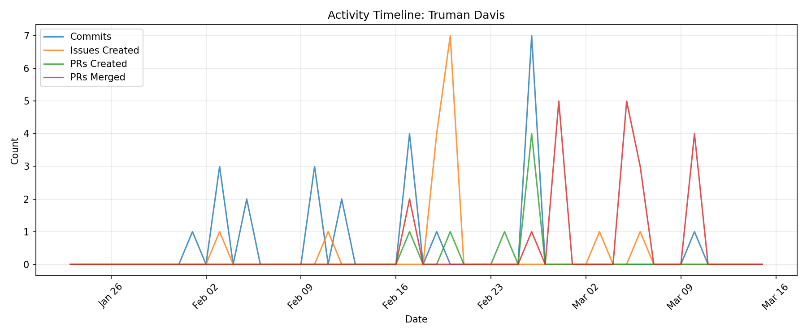

# Contributor Report: Truman Davis

**GitHub Username(s):** TrumanAD
**Email(s):** truman.davis@du.edu
**Report Generated:** 2026-03-15 16:02:31
**Branches Analyzed:** origin/sprint-3

---

## Summary

| Metric | Count |
|--------|-------|
| Total Commits | 24 |
| Lines Added | 200,254 |
| Lines Deleted | 185,926 |
| Net Lines Changed | +14,328 |
| PRs Created | 7 |
| PRs Assigned | 0 |
| PRs Reviewed | 2 |
| PRs Commented | 0 |
| PRs Merged (as merger) | 20 |
| Issues Created | 15 |
| Issues Commented | 6 |
| Files Changed | 49 |

---

## Issues

### Created (15)
#78, #151, #297, #304, #305, #309, #314, #316, #317, #318, #323, #333, #334, #481, #542

### Commented (6)
#232, #297, #304, #323, #481, #542

---

## Pull Requests

### Created (7)
#207, #332, #372, #407, #408, #409, #411

### Assigned (0)
None

### Reviewed (2)
#183, #184

### Commented (0)
None

### Merged (as merger) (20)
#200, #201, #366, #411, #441, #444, #445, #452, #505, #523, #526, #527, #536, #538, #541, #544, #567, #569, #572, #584

---

## Commits

Total non-merge commits in sprint-3 branch: **24**

### Code Changes
- **Lines Added:** 200,254
- **Lines Deleted:** 185,926
- **Net Change:** +14,328

---

## Files Changed (49)

- `data/generated_data/terrestrial_truck.json`
- `data/training/metadata.json`
- `data/training/route_hub_denver_01_to_hub_estes_park_01.json`
- `data/training/route_hub_denver_01_to_hub_estes_park_01_drift.json`
- `data/training/route_hub_denver_01_to_hub_estes_park_01_dropout.json`
- `data/training/route_hub_denver_01_to_hub_estes_park_01_motion_mismatch.json`
- `data/training/route_hub_denver_01_to_hub_estes_park_01_spike.json`
- `data/training/route_hub_denver_01_to_hub_idaho_springs_01.json`
- `data/training/route_hub_denver_01_to_hub_idaho_springs_01_drift.json`
- `data/training/route_hub_denver_01_to_hub_idaho_springs_01_dropout.json`
- `data/training/route_hub_denver_01_to_hub_idaho_springs_01_motion_mismatch.json`
- `data/training/route_hub_denver_01_to_hub_idaho_springs_01_spike.json`
- `data/training/route_hub_estes_park_01_to_hub_denver_01.json`
- `data/training/route_hub_estes_park_01_to_hub_denver_01_drift.json`
- `data/training/route_hub_estes_park_01_to_hub_denver_01_dropout.json`
- `data/training/route_hub_estes_park_01_to_hub_denver_01_motion_mismatch.json`
- `data/training/route_hub_estes_park_01_to_hub_denver_01_spike.json`
- `data/training/route_hub_estes_park_01_to_hub_idaho_springs_01.json`
- `data/training/route_hub_estes_park_01_to_hub_idaho_springs_01_drift.json`
- `data/training/route_hub_estes_park_01_to_hub_idaho_springs_01_dropout.json`
- `data/training/route_hub_estes_park_01_to_hub_idaho_springs_01_motion_mismatch.json`
- `data/training/route_hub_estes_park_01_to_hub_idaho_springs_01_spike.json`
- `data/training/route_hub_idaho_springs_01_to_hub_denver_01.json`
- `data/training/route_hub_idaho_springs_01_to_hub_denver_01_drift.json`
- `data/training/route_hub_idaho_springs_01_to_hub_denver_01_dropout.json`
- `data/training/route_hub_idaho_springs_01_to_hub_denver_01_motion_mismatch.json`
- `data/training/route_hub_idaho_springs_01_to_hub_denver_01_spike.json`
- `data/training/route_hub_idaho_springs_01_to_hub_estes_park_01.json`
- `data/training/route_hub_idaho_springs_01_to_hub_estes_park_01_drift.json`
- `data/training/route_hub_idaho_springs_01_to_hub_estes_park_01_dropout.json`
- `data/training/route_hub_idaho_springs_01_to_hub_estes_park_01_motion_mismatch.json`
- `data/training/route_hub_idaho_springs_01_to_hub_estes_park_01_spike.json`
- `machine-learning/classifier_preparation.py`
- `machine-learning/model_training.py`
- `machine-learning/train_classifier.py`
- `ml/classifier/normalization_stats.json`
- `ml/classifier_preparation.py`
- `ml/data_pipeline.py`
- `ml/feature_extraction.py`
- `ml/model_training.py`
- `ml/models/inference_results.json`
- `ml/models/motion_classifier.pt`
- `ml/models/training_history.json`
- `ml/requirements.txt`
- `ml/train_classifier.py`
- `models/inference_results.json`
- `models/motion_classifier.pt`
- `models/training_history.json`
- `requirements.txt`

---

## Timeline

