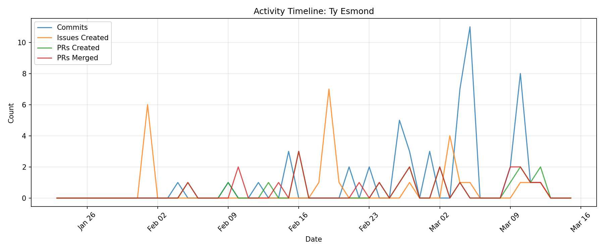

# Contributor Report: Ty Esmond

**GitHub Username(s):** TyEsmond, Troo4
**Email(s):** 165939755+TyEsmond@users.noreply.github.com, ty@the3.com
**Report Generated:** 2026-03-15 16:01:37
**Branches Analyzed:** origin/sprint-3

---

## Summary

| Metric | Count |
|--------|-------|
| Total Commits | 51 |
| Lines Added | 2,162 |
| Lines Deleted | 1,723 |
| Net Lines Changed | +439 |
| PRs Created | 19 |
| PRs Assigned | 11 |
| PRs Reviewed | 15 |
| PRs Commented | 14 |
| PRs Merged (as merger) | 21 |
| Issues Created | 25 |
| Issues Commented | 3 |
| Files Changed | 15 |

---

## Issues

### Created (25)
#39, #40, #41, #42, #43, #44, #213, #246, #249, #250, #253, #294, #295, #306, #345, #434, #479, #480, #483, #486, #504, #531, #571, #588, #600

### Commented (3)
#221, #313, #358

---

## Pull Requests

### Created (19)
#107, #144, #172, #186, #195, #199, #358, #427, #435, #439, #453, #458, #506, #558, #562, #573, #590, #594, #602

### Assigned (11)
#107, #336, #337, #350, #396, #397, #427, #456, #546, #573, #602

### Reviewed (15)
#145, #173, #336, #337, #347, #350, #353, #397, #399, #456, #459, #546, #548, #585, #607

### Commented (14)
#145, #173, #336, #337, #347, #350, #397, #399, #456, #459, #546, #548, #585, #607

### Merged (as merger) (21)
#107, #144, #145, #172, #186, #195, #199, #347, #358, #427, #435, #439, #453, #458, #506, #548, #558, #562, #573, #590, #602

---

## Commits

Total non-merge commits in sprint-3 branch: **51**

### Code Changes
- **Lines Added:** 2,162
- **Lines Deleted:** 1,723
- **Net Change:** +439

---

## Files Changed (15)

- `ui/README.md`
- `ui/redis_reader.py`
- `ui/redis_tester.py`
- `ui/requirements.txt`
- `ui/widgets/analytics_tab.py`
- `ui/widgets/anomalies_tab.py`
- `ui/widgets/dashboard_main.py`
- `ui/widgets/ml_data.json`
- `ui/widgets/network_tab.py`
- `ui/widgets/node_details_tab.py`
- `ui/widgets/parent_classes.py`
- `ui/widgets/raw_data.json`
- `ui/widgets/redis_tester.py`
- `ui/widgets/test_nodesV2.json`
- `ui/widgets/widgetextras/redis_tester.py`

---

## Timeline

